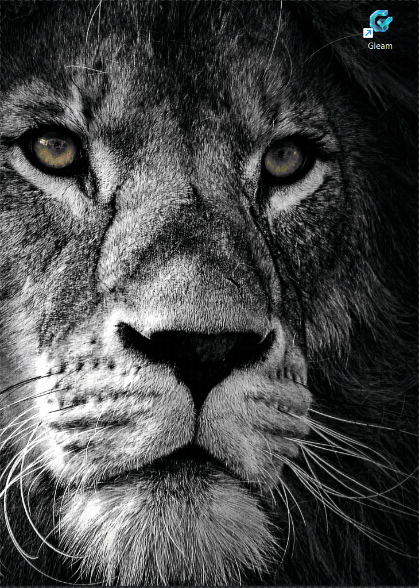
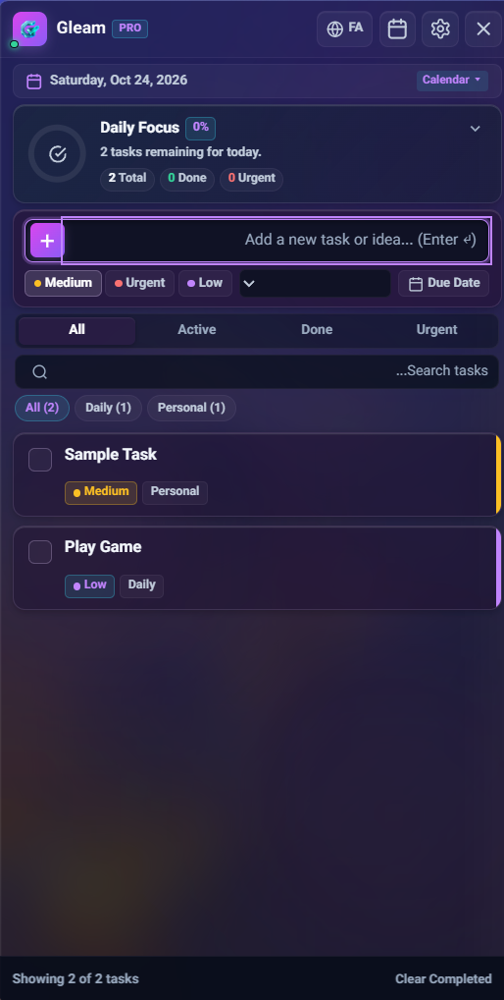
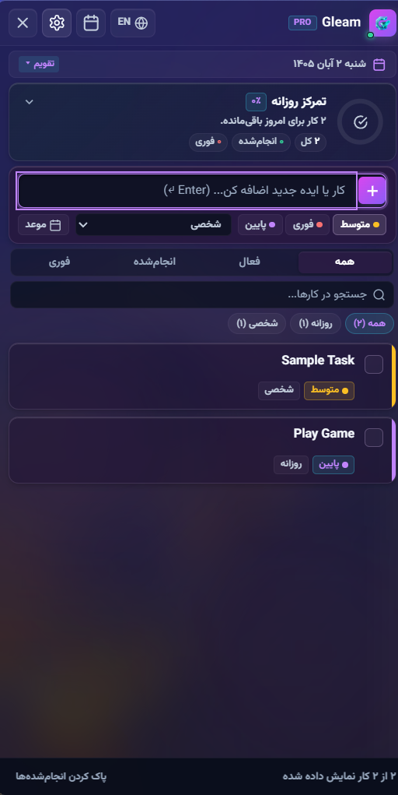
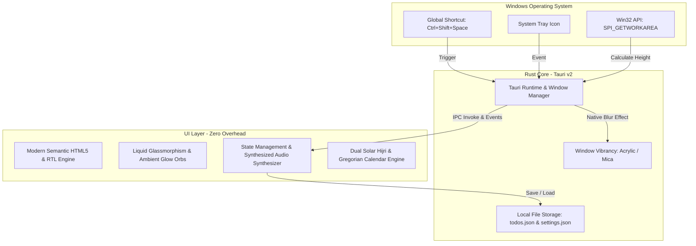

<p align="center">
  
</p>

<p align="center">
  <strong>Gleam</strong> — A sleek, modern right-docked task drawer engineered with <strong>Tauri v2</strong>, <strong>Rust</strong>, and luxury <strong>Frosted Glassmorphism</strong>.
</p>

<p align="center">
  <a href="https://tauri.app/"></a>
  <a href="https://www.rust-lang.org/"></a>
  
  
  
  <a href="https://github.com/amirrezamortazavifard/Gleam/releases/latest"></a>
  <a href="https://github.com/amirrezamortazavifard/Gleam/stargazers"></a>
  <a href="LICENSE"></a>
</p>

<p align="center">
  <a href="https://github.com/amirrezamortazavifard/Gleam/releases/latest">
    
  </a>
</p>

---

<p align="center">
  <a href="#-about-gleam">About</a> •
  <a href="#-live-demonstration">Live Demo</a> •
  <a href="#-key-features">Key Features</a> •
  <a href="#-interface-preview">Preview</a> •
  <a href="#-keyboard-shortcuts">Shortcuts</a> •
  <a href="#-color-themes">Themes</a> •
  <a href="#-technical-architecture">Architecture</a> •
  <a href="#-getting-started">Getting Started</a> •
  <a href="#-stargazers-over-time">Stars</a> •
  <a href="#-license">License</a>
</p>

---

## 📖 About Gleam

**Gleam** is a desktop productivity drawer designed to eliminate window clutter and bring instant task capture to your fingertips. Unlike traditional task managers that consume taskbar real estate and require bulky application windows, **Gleam** resides silently in the Windows System Tray and glides into view with a single global hotkey (**`Ctrl + Shift + Space`**).

Drawing inspiration from **Apple Control Center** and **Windows Acrylic/Mica**, Gleam wraps high-performance native Rust APIs in a liquid frosted-glass aesthetic. It delivers instant responsiveness, crystal chimes, dual-calendar scheduling, and comprehensive task management in a featherweight footprint.

---

## 🎬 Live Demonstration

<p align="center">
  
</p>

*Watch Gleam slide in from the screen edge with zero taskbar intrusion, smooth frosted glass refractions, and instant task completion feedback.*

---

## 🖼 Interface Preview

<p align="center">
  
  &nbsp;
  
</p>

<p align="center">
  <em>Left: English (LTR) mode with Gregorian calendar &bull; Right: Persian (RTL) mode with Solar Hijri (Jalali) calendar</em>
</p>

---

## ✨ Key Features

### 🪟 1. Right-Docked Edge Drawer
- **Intelligent Work Area Snapping:** Uses native Windows Win32 APIs (`SPI_GETWORKAREA`) to automatically calculate your screen's visible area, docking flush against the right screen edge and stretching seamlessly from the top of the monitor down to the taskbar.
- **Zero Taskbar Footprint (`skipTaskbar: true`):** Keeps your primary workspace pristine by operating exclusively from the System Tray.
- **Fluid Micro-Animations:** Silky 60+ FPS slide-in and slide-out transitions.

### ⌨️ 2. Global Hotkey Access
- Summon or dismiss the drawer instantly from within any game, IDE, or full-screen app via **`Ctrl + Shift + Space`**.
- Optional **Close on Blur** automatically conceals the panel whenever you click away.

### 🎨 3. Luminous Frosted Glassmorphism
- **Deep Acrylic & Mica Vibrancy:** Hardware-accelerated background blur through Tauri's window vibrancy integration.
- **Floating Ambient Glow Orbs:** Dynamic, animated light spheres hovering behind the frosted acrylic sheets to simulate real-world caustics and light refractions.
- **Prismatic Edge Highlights:** Beveled glass contours with subtle chromatic aberration flares.

### 📅 4. Dual-Calendar Engine (Persian & Gregorian)
- Built-in full **Persian (Solar Hijri / Jalali) Calendar** alongside standard Gregorian dates.
- Interactive daily date banner with quick due-date shortcuts (*Today*, *Tomorrow*, *Next Saturday*, or *No Due Date*).
- Visual status indicators for due today and overdue items.

### 🌐 5. Native Bilingual Support (LTR & RTL)
- Seamless one-click switching between **English (LTR)** and **Persian (RTL)**.
- Precision typography pairing: **Plus Jakarta Sans** for Latin script and **Vazirmatn** for Arabic/Persian script.

### ⚡ 6. Comprehensive Productivity Suite
- **Circular Daily Focus Ring:** Real-time visual progress wheel displaying completion percentages and task statistics (Total, Done, Urgent).
- **Subtasks & Checklists:** Expandable subtask breakdowns within each card.
- **Priority Matrix:** 3-tier color-coded urgency levels (High 🔴, Medium 🟡, Low 🔵).
- **Categorization:** Pre-configured and customizable categories (Work, Personal, Projects, Study, Health, Ideas) with rapid horizontal filter chips.
- **Synthesized Crystal Audio:** Harmonic chime synthesized in real-time via the Web Audio API upon completing tasks.
- **Instant Search:** High-speed filter across task titles, notes, and tags.
- **JSON Data Portability:** Single-click export and import of your task database.

---

## 🎨 Color Themes

Gleam comes packaged with five curated luxury frosted glass themes:

| Theme | Color Palette | Inspiration |
| :--- | :--- | :--- |
| **Apple Frost** *(Default)* | Frosted crystal + Ice cyan glow | Apple Control Center translucent frosted glass |
| **Obsidian** | Deep midnight slate + Neon azure | Galactic dark crystal with beveled highlights |
| **Sapphire** | Royal navy + Radiant electric blue | Oceanic depths with high-contrast vibrancy |
| **Aurora** | Cyberpunk magenta + Electric violet | Polar auroral flares with warm luminous glows |
| **Emerald** | Deep jade + Crisp mint crystal | Serene mineral green with frosted transparency |

---

## ⌨️ Keyboard Shortcuts

| Shortcut | Action |
| :--- | :--- |
| `Ctrl + Shift + Space` | Toggle Gleam drawer globally from any application |
| `Enter ↵` | Quick-add task from input field |
| `Esc` | Hide drawer to System Tray |
| `Left Click (Tray Icon)` | Toggle drawer visibility |
| `Right Click (Tray Icon)` | Context menu: Quick Add, Open/Close, Exit |

---

## 🛠 Technical Architecture



- **Featherweight Footprint:** Built with **Rust** and **Tauri v2**, consuming only **~25–40 MB of RAM** (up to 10x lighter than typical Electron-based productivity tools).
- **Zero Heavy Frameworks:** Pure, modern ES6+ JavaScript and optimized CSS ensuring silky 60+ FPS transitions and sub-millisecond input response.
- **Local-First Privacy:** All tasks and settings are persisted locally on your machine with zero cloud tracking:
  ```text
  %LOCALAPPDATA%\Gleam\todos.json
  %LOCALAPPDATA%\Gleam\settings.json
  ```

---

## 🚀 Getting Started

### Prerequisites
- [Node.js](https://nodejs.org/) (v18 or later)
- [Rust & Cargo](https://www.rust-lang.org/tools/install)
- **Windows 10 / 11** (recommended for full Acrylic and Mica window vibrancy effects)

### Installation
```bash
# 1. Clone the repository
git clone https://github.com/amirrezamortazavifard/Gleam.git
cd Gleam

# 2. Install dependencies
npm install
```

### Development Mode
Run the development environment with hot reloading:
```bash
npm run tauri dev
```

### Production Build
Compile an optimized native Windows binary (`.exe`) and standalone installer:
```bash
npm run tauri build
```
The compiled binary will be generated at:
```text
src-tauri/target/release/Gleam.exe
```

---

## ⭐ Stargazers Over Time

[](https://star-history.com/#amirrezamortazavifard/Gleam&Date)

---

## 🤝 Contributing

Contributions, issues, and feature requests are welcome! Feel free to check the [issues page](https://github.com/amirrezamortazavifard/Gleam/issues).

1. Fork the Project
2. Create your Feature Branch (`git checkout -b feat/AmazingFeature`)
3. Commit your Changes (`git commit -m 'feat: Add some AmazingFeature'`)
4. Push to the Branch (`git push origin feat/AmazingFeature`)
5. Open a Pull Request

---

## 📄 License

Distributed under the **MIT** License. See [LICENSE](LICENSE) for more information.

<p align="center">
  Crafted with precision, frosted glass, and light.
</p>
